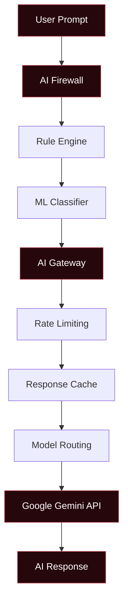

<div align="center">


<br/>

[](https://github.com/atiyahhkhann)
[](https://github.com/atiyahhkhann)
[](https://github.com/atiyahhkhann)

<br/>

**BUILD. EXPERIMENT. LEARN. REPEAT.**

</div>

---

## `01` — About Me

<table>
<tr>
<td width="65%" valign="middle">

### Hey, I'm Atiyah Khan! 👋

I'm an **AI / ML student** exploring the world of Artificial Intelligence, Machine Learning, and Generative AI.

I enjoy understanding how AI systems work, experimenting with new technologies, and turning concepts into practical projects.

Currently focused on:

- Exploring Generative AI and Large Language Models.
- Understanding machine learning fundamentals.
- Building AI-powered applications using JavaScript.
- Experimenting with Google Gemini API.
- Learning about AI security, gateways, and intelligent filtering.

**My philosophy:** Learn by building, improve through experimentation, and share the journey.

</td>
<td width="35%" align="center" valign="middle">


<br/>

[GitHub Profile](https://github.com/atiyahhkhann)

</td>
</tr>
</table>

---

## `02` — Current Focus

<table>
<tr>
<td width="50%" valign="top">

### Artificial Intelligence

- Generative AI
- Large Language Models
- Prompt Engineering
- Gemini API
- AI-powered applications

</td>
<td width="50%" valign="top">

### Machine Learning

- ML fundamentals
- Classification algorithms
- Naive Bayes
- Pattern recognition
- Intelligent filtering

</td>
</tr>
</table>

---

## `03` — Featured Projects

### <a href="https://github.com/atiyahhkhann/AI-Gateways-and-Firewalls">AI Gateways & Firewalls</a>

<kbd>JavaScript</kbd> <kbd>Google Gemini API</kbd> <kbd>Machine Learning</kbd>

An experimental project combining an AI Firewall and AI Gateway to introduce security controls and traffic management in front of an AI-powered chatbot.

**System Architecture**



**Key components**

| Component | Function |
|---|---|
| Rule Engine | Detects known suspicious patterns |
| ML Classifier | Classifies potentially harmful prompts |
| Rate Limiter | Controls request frequency |
| Response Cache | Reuses eligible cached responses |
| Model Router | Routes requests to Gemini models |

[](https://github.com/atiyahhkhann/AI-Gateways-and-Firewalls)

---

### <a href="https://github.com/atiyahhkhann/GenAi-Notes">GenAI Notes</a>

<kbd>Generative AI</kbd> <kbd>Learning Resources</kbd> <kbd>Infographics</kbd>

A collection of self-written notes and visual learning resources covering Generative AI concepts.

**Topics explored**

- Generative AI fundamentals
- Traditional AI vs Generative AI
- How models learn patterns
- Latent representations
- From prompts to generated outputs

[](https://github.com/atiyahhkhann/GenAi-Notes)

---

## `04` — Visual Knowledge Base

<div align="center">

### Learning Generative AI Through Visuals

<table>
<tr>
<td width="50%" align="center">

**Generative AI Workflow**

<a href="https://raw.githubusercontent.com/atiyahhkhann/GenAi-Notes/main/images/Generative%20AI%20Workflow%20Infographic.png">

</a>

</td>
<td width="50%" align="center">

**Traditional AI vs Generative AI**

<a href="https://raw.githubusercontent.com/atiyahhkhann/GenAi-Notes/main/images/Traditional%20AI%20vs%20Generative%20AI%20Infographic.png">

</a>

</td>
</tr>
<tr>
<td width="50%" align="center">

**Training Patterns into Latent Knowledge**

<a href="https://raw.githubusercontent.com/atiyahhkhann/GenAi-Notes/main/images/Training%20Patterns%20into%20Latent%20Knowledge.png">

</a>

</td>
<td width="50%" align="center">

**From Prompt to Polished Possibilities**

<a href="https://raw.githubusercontent.com/atiyahhkhann/GenAi-Notes/main/images/From%20Prompt%20to%20Polished%20Possibilities.png">

</a>

</td>
</tr>
</table>

</div>

---

## `05` — Technical Arsenal

<div align="center">

### Languages


### AI / ML & Tools


### Areas of Interest


</div>

---

## `06` — GitHub Analytics

<div align="center">


<br/><br/>


<br/><br/>


</div>

---

## `07` — Let's Connect

<div align="center">

### Ideas become better when shared.

I'm interested in learning, collaborating, experimenting, and building useful AI-powered applications.

<br/>

<a href="https://github.com/atiyahhkhann">

</a>

<br/><br/>

```bash
$ whoami
Atiyah Khan

$ current_status
Learning | Experimenting | Building

$ next_objective
Build something meaningful with AI.
```

<br/>

**Thanks for visiting my profile!**


</div>
